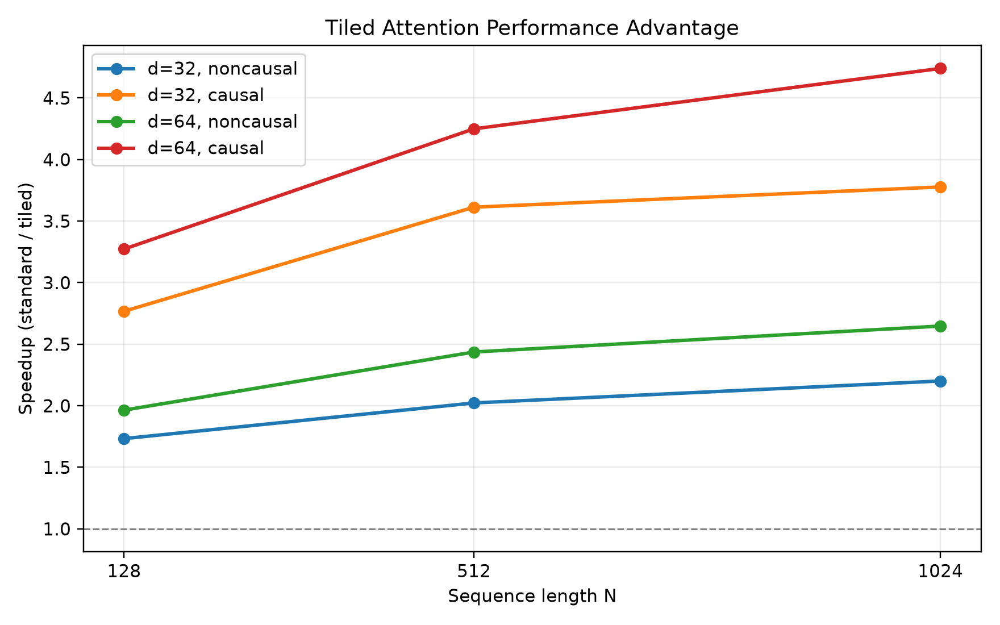
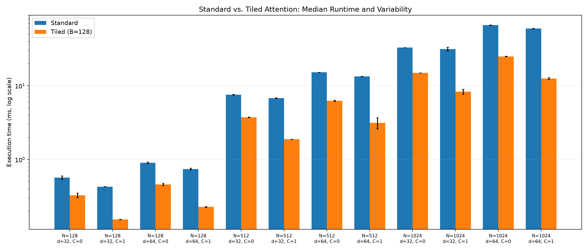
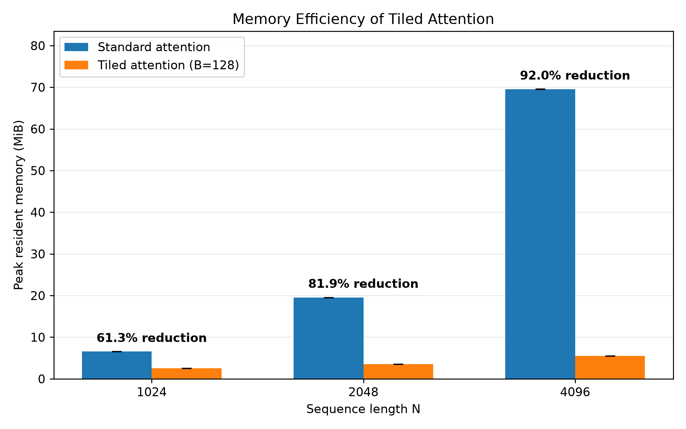

# AutoAttn

### Adaptive and Memory-Efficient Transformer Attention Engine in C++

AutoAttn is a lightweight, CPU-based Transformer attention engine written in C++17. It implements conventional scaled dot-product attention, memory-efficient tiled attention using online softmax, and an adaptive execution policy that selects a kernel configuration based on workload characteristics, measured performance, and memory constraints.

The project explores a central problem in efficient Transformer computation: **how can attention be evaluated without materializing the full attention matrix, while preserving numerical accuracy and minimizing execution time?**

AutoAttn provides an end-to-end implementation, from contiguous matrix storage and attention kernels to memory-aware dispatch, calibration, benchmarking, and numerical validation.

## Highlights

- **Standard attention:** Numerically stable scaled dot-product attention with a materialized score matrix.
- **Tiled attention:** Streaming, blockwise attention using online softmax without an explicit full attention matrix.
- **Adaptive execution:** Runtime selection of algorithms and tile sizes using benchmark calibration and memory constraints.
- **Memory-aware dispatch:** Explicit scratch-memory estimation and budget enforcement.
- **Causal attention:** Support for causal and noncausal attention.
- **Custom C++ matrix abstraction:** Templated, contiguous, row-major storage.
- **Command-line interface:** Deterministic synthetic inputs or user-provided CSV matrices.
- **Reproducibility:** Automated tests, benchmark scripts, calibration data, and experimental results.

## Performance Highlights

AutoAttn was evaluated using optimized C++17 implementations on an Apple Silicon MacBook Pro.

| Metric | Observed result |
|---|---|
| Maximum tiled-attention speedup | **4.74x** |
| Workloads where tiled attention was faster | **12 / 12** |
| Peak memory reduction at N=4096 | **92.05%** |
| Runtime benchmark measurements | 120 |
| Memory benchmark measurements | 30 |
| Automated tests | 12 passing |

The runtime comparison uses five measured repetitions per configuration, across three sequence lengths, two feature dimensions, and both causal and noncausal attention.

These results compare the project's own standard and tiled CPU implementations, not production attention libraries.

### Runtime Performance



The tiled implementation achieves speedups ranging from approximately **1.73x to 4.74x** across the tested workloads.

The largest observed speedup occurs for causal attention with sequence length 1024 and feature dimension 64.



### Memory Efficiency



Median peak resident memory over five executions:

| Sequence length | Standard attention | Tiled attention | Reduction |
|---|---:|---:|---:|
| 1024 | 6.547 MiB | 2.531 MiB | 61.34% |
| 2048 | 19.547 MiB | 3.531 MiB | 81.93% |
| 4096 | 69.547 MiB | 5.531 MiB | 92.05% |

At N=4096, avoiding the full float32 attention-score matrix eliminates approximately 64 MiB of temporary matrix storage.

Peak process RSS includes input matrices, output storage, temporary allocations, and runtime overhead. It is distinct from the dispatcher's estimated scratch-memory requirement.

## Architecture

AutoAttn separates attention computation, memory estimation, kernel selection, and data handling into independent C++ components.

```text
               Input Q, K, V
                     |
                     v
              Attention Engine
                     |
                     v
              Adaptive Dispatcher
                 /         \
                /           \
       Calibration       Memory Budget
          Profile          Estimator
                \           /
                 \         /
                     |
               Kernel Selection
                  /       \
                 /         \
        Standard           Tiled
        Attention          Attention
                 \         /
                  \       /
                     |
                Output Matrix
                     |
                CSV + Metrics
```

### Core Components

| Component | Responsibility |
|---|---|
| `matrix.hpp` | Templated contiguous matrix representation |
| `standard_attention.hpp` | Conventional scaled dot-product attention |
| `tiled_attention.hpp` | Blockwise streaming attention with online softmax |
| `memory_estimator.hpp` | Scratch-memory estimation |
| `dispatch_policy.hpp` | Algorithm and block-size selection |
| `calibration_io.hpp` | Loading benchmark calibration profiles |
| `attention_engine.hpp` | Integration of dispatch and attention execution |
| `csv_io.hpp` | Matrix serialization and input validation |
| `path_safety.hpp` | Protection against accidental input-file overwrites |
| `src/main.cpp` | Command-line application |

## Algorithms

### 1. Standard Scaled Dot-Product Attention

Given query, key, and value matrices,

$$
Q \in \mathbb{R}^{N \times d},\quad K \in \mathbb{R}^{M \times d},\quad V \in \mathbb{R}^{M \times d_v}
$$

attention is evaluated as

$$
\mathrm{Attention}(Q,K,V) = \mathrm{softmax}\left(\frac{QK^\top}{\sqrt{d}}\right)V
$$

The baseline implementation explicitly stores the N-by-M attention-score matrix and uses numerically stable softmax normalization.

### 2. Tiled Attention with Online Softmax

The tiled implementation divides the key sequence into blocks and incrementally updates the softmax normalization.

For each query row, it maintains:

- A running maximum for numerical stability.
- A running softmax normalization factor.
- An accumulated weighted value vector.

When the running maximum changes, previous contributions are rescaled before incorporating the next block.

This avoids materializing the full attention-score matrix.

Unlike GPU FlashAttention implementations, the current CPU kernel processes one query row at a time and tiles across the key dimension.

### 3. Adaptive Dispatch

AutoAttn selects an attention implementation subject to a user-specified scratch-memory budget.

For workloads with exact matching calibration measurements, the dispatcher selects the fastest measured feasible configuration.

For unseen workloads, it applies a deterministic memory-aware fallback policy.

The current dispatcher uses exact workload matching rather than an interpolated performance model.

## Computational Complexity

Let N be the number of queries, M the number of keys, d the query/key dimension, dv the value dimension, and B the key-block size.

| Implementation | Arithmetic complexity | Auxiliary space |
|---|---|---|
| Standard attention | O(NMd + NMdv) | O(NM) |
| Tiled attention | O(NMd + NMdv) | O(min(B,M) + dv) |

The auxiliary-space expressions exclude input and output matrices.

Both algorithms have the same asymptotic arithmetic complexity. Tiled attention reduces temporary memory requirements and can improve practical execution time through its streaming computation and memory-access behavior.

## Requirements

- C++17-compatible compiler
- CMake
- Python 3 for benchmark and integration scripts
- NumPy for independent numerical reference tests
- Matplotlib for generating experimental figures

The core C++ implementation requires no CUDA, GPU backend, or external numerical computing library.

## Build

Clone the repository:

```bash
git clone https://github.com/sbathula-MML/autoattn-cpp.git
cd autoattn-cpp
```

Build the optimized executable:

```bash
cmake -S . -B build-release -DCMAKE_BUILD_TYPE=Release
cmake --build build-release -j 4
```

The executable is available at:

```text
build-release/autoattn
```

## Usage

### Adaptive Execution

```bash
./build-release/autoattn run \
  --n 256 \
  --d 64 \
  --seed 7 \
  --mode auto \
  --budget-bytes 4096 \
  --out attention.csv \
  --meta metrics.json
```

This selects an algorithm and block size according to the calibration profile and available scratch-memory budget.

### Standard Attention

```bash
./build-release/autoattn run \
  --n 256 \
  --d 64 \
  --mode standard \
  --budget-bytes 300000 \
  --out standard.csv \
  --meta standard.json
```

### Tiled Attention

```bash
./build-release/autoattn run \
  --n 256 \
  --d 64 \
  --mode tiled \
  --block 128 \
  --budget-bytes 4096 \
  --out tiled.csv \
  --meta tiled.json
```

Use `--causal` to enable causal masking.

### Custom Input Matrices

```bash
./build-release/autoattn run \
  --q tests/Q_sample.csv \
  --k tests/K_sample.csv \
  --v tests/V_sample.csv \
  --mode auto \
  --out output.csv \
  --meta output.json
```

The application writes the attention output to CSV and execution metadata to JSON.

## Implementation and Verification

The following table connects AutoAttn's core functionality to its implementation and validation.

| Functionality | Implementation | Verification |
|---|---|---|
| Contiguous matrix storage | `include/matrix.hpp` | `tests/test_matrix.cpp`, `tests/test_matrix_boundaries.cpp` |
| Standard scaled dot-product attention | `include/standard_attention.hpp` | `tests/test_attention.cpp` |
| Streaming tiled attention | `include/tiled_attention.hpp` | `tests/test_tiled_attention.cpp` |
| Memory-aware algorithm selection | `include/dispatch_policy.hpp`, `include/memory_estimator.hpp` | `tests/test_dispatch_policy.cpp`, `tests/test_memory_estimator.cpp` |
| Integrated attention execution | `include/attention_engine.hpp` | `tests/test_attention_engine.cpp` |
| Benchmark-based calibration | `include/calibration_io.hpp` | `tests/test_calibration_io.cpp`, `tests/test_calibration_validation.py` |
| CSV input/output and validation | `include/csv_io.hpp`, `src/main.cpp` | `tests/test_csv_io.cpp`, `tests/test_cli_integration.py` |
| File overwrite protection | `include/path_safety.hpp` | `tests/test_path_safety.py` |
| Independent numerical correctness | Attention kernels | `tests/test_numpy_reference.py` |
| Runtime scaling and variability | `benchmarks/run_final_benchmarks.py` | `benchmarks/final_runs.csv`, `figures/final_runtime.pdf` |
| Peak resident memory | `benchmarks/run_final_memory.py` | `benchmarks/final_memory_runs.csv`, `figures/final_memory.pdf` |
| Adaptive policy behavior | Calibration and dispatch modules | `benchmarks/calibration_grid.csv`, `benchmarks/heldout_results.csv` |

## Testing and Validation

AutoAttn includes automated unit and integration tests covering:

- Matrix construction, indexing, and boundary conditions
- Standard and tiled attention correctness
- Causal masking
- Online-softmax numerical behavior
- Memory estimation and dispatch
- CSV and calibration-file validation
- Command-line integration
- Input/output path safety

Run the test suite:

```bash
ctest --test-dir build-release --output-on-failure
```

Independent NumPy reference comparisons validate numerical correctness across multiple inputs and attention configurations.

A diagnostic build using compiler warnings, AddressSanitizer, and UndefinedBehaviorSanitizer also passed all 12 registered tests without reported sanitizer errors.

## Reproducing Experiments

### Runtime Benchmarks

```bash
python3 benchmarks/run_final_benchmarks.py
```

The benchmark evaluates:

- Sequence lengths: 128, 512, 1024
- Feature dimensions: 32, 64
- Causal and noncausal attention
- Standard and tiled kernels
- Five measured repetitions per configuration

Results:

- `benchmarks/final_runs.csv`
- `benchmarks/final_summary.csv`

### Peak Memory Benchmarks

On macOS:

```bash
python3 benchmarks/run_final_memory.py
```

Uses `/usr/bin/time -l` to measure peak resident memory across sequence lengths 1024, 2048, and 4096.

Results:

- `benchmarks/final_memory_runs.csv`
- `benchmarks/final_memory_summary.csv`

### Regenerating Figures

Install the plotting dependency:

```bash
python3 -m pip install matplotlib
```

Generate the plots:

```bash
python3 benchmarks/plot_final_results.py
python3 benchmarks/plot_memory_results.py
```

The figures are saved in `figures/` in PNG and PDF formats.

## Project Structure

```text
autoattn-cpp/
├── CMakeLists.txt
├── include/
│   ├── matrix.hpp
│   ├── standard_attention.hpp
│   ├── tiled_attention.hpp
│   ├── attention_engine.hpp
│   ├── dispatch_policy.hpp
│   ├── memory_estimator.hpp
│   ├── calibration_io.hpp
│   ├── csv_io.hpp
│   └── path_safety.hpp
├── src/
│   └── main.cpp
├── tests/
│   └── ...
├── benchmarks/
│   └── ...
└── figures/
    └── ...
```

## Limitations and Future Work

AutoAttn is an experimental CPU attention engine rather than a production inference backend.

Current limitations include:

- Single-query-row streaming instead of fully two-dimensional tiled execution
- Exact-match calibration with heuristic fallback for unseen workloads
- No GPU kernel implementation
- No automatic differentiation or Transformer training framework
- No optimized SIMD or multithreaded execution

Potential extensions include vectorized kernels, multithreading, richer calibration models, multihead execution, and GPU acceleration.

## References

1. Vaswani et al. (2017). *Attention Is All You Need.* https://arxiv.org/abs/1706.03762

2. Milakov and Gimelshein (2018). *Online normalizer calculation for softmax.* https://arxiv.org/abs/1805.02867

3. Dao et al. (2022). *FlashAttention: Fast and Memory-Efficient Exact Attention with IO-Awareness.* https://arxiv.org/abs/2205.14135

## Author

**Satwik Bathula**  
University of Southern California  
Email: sbathula@usc.edu
